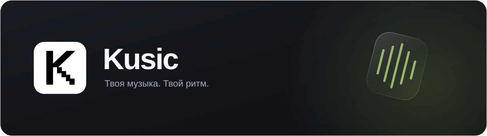

  

  Музыкальный плеер, который подстраивается под тебя. 
  Собирай коллекцию, находи музыку и выбирай, как она звучит и выглядит.

  

  Windows 10 / 11 · 64 бит 
  <a href="https://github.com/DisgraceThisConstant/kusic-updates/releases">Что нового</a> &nbsp;·&nbsp;
  <a href="https://github.com/DisgraceThisConstant/kusic-updates/issues">Сообщить о проблеме</a>

---

### Музыка на твоих условиях

| 🎵 Вся коллекция рядом | 🔎 Найти и добавить |
| :--- | :--- |
| Свои треки, альбомы и плейлисты в одном месте. | Поиск в библиотеке и интернете, импорт своей музыки. |
| **◉ Мини-плеер** | **▦ Виджет рабочего стола** |
| Компактное управление, когда занят другими делами. | Музыка прямо на рабочем столе: свой вид, положение и реакция на звучание. |
| **🎚️ Твоё звучание** | **✦ Твой стиль** |
| Эквалайзер и настройки звука под твой вкус. | Темы, акценты, плавные переходы и стеклянные элементы. |

### Установить и слушать

1. **Скачай установщик** по кнопке выше.
2. **Выбери папки** для плеера, коллекции и музыки.
3. **Добавь свои треки** и настрой Kusic под себя.

Уже пользуешься Kusic? Установщик найдёт прежнюю установку и предложит обновить её — в том числе старый клиент без встроенных обновлений. Музыка, плейлисты и настройки сохранятся.

### Обновления без лишних действий

Новые стабильные версии появляются в **Настройки → Обновления**. Kusic показывает изменения и сообщает о новой версии индикатором рядом с настройками. Фоновую загрузку можно включить или отключить.

Хочешь попробовать новое раньше? Экспериментальные сборки предлагаются отдельно, с описанием и предупреждением о возможных ошибках. Они скачиваются и устанавливаются по твоему решению. Предложения можно отключить.

<b>Если используешь раннюю сборку</b>

Один раз запусти свежий установщик вручную. Он обновит прежний клиент и сохранит коллекцию. Это также подходит для промежуточных сборок с прежней нумерацией версий. Дальнейшие обновления будут доступны в самом плеере.

Для переносной сборки установщик подключит существующую коллекцию и сохранит исходную папку.

<b>Проверка скачанного файла</b>

Рядом с установщиком на странице релиза находится файл `.sha256` для проверки целостности. Встроенное обновление проверяет размер и контрольную сумму перед установкой.

 

   
  Kusic · Твоя музыка. Твой ритм.

